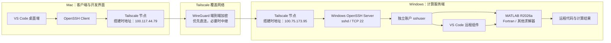
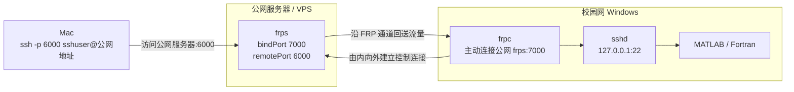

# Tailscale-OpenSSH-VSCode-Remote-SSH-PS
# Mac—Windows 远程开发与 MATLAB 计算架构

更新日期：2026-07-24

## 1. 目标与定位

本架构使用 Mac 作为日常开发客户端，使用校园网络中的 Windows 主机作为远程计算服务端。Mac 通过 Tailscale 和 OpenSSH 访问 Windows，并通过 VS Code Remote - SSH 编辑 Windows 上的代码、启动 MATLAB/Fortran 程序和查看计算结果。

这里的“服务端”是 Windows 在本方案中承担的功能角色，不表示操作系统是 Windows Server。现有诊断信息显示目标主机实际运行 Windows 11 家庭版。

当前推荐链路为：

```text
Mac
  → Tailscale 加密覆盖网络
  → Windows OpenSSH Server
  → sshuser
  → VS Code Remote - SSH / PowerShell
  → MATLAB 或 Fortran 求解器
  → Windows 上的计算结果
```

## 2. 当前正式架构：Tailscale + OpenSSH



### 2.1 组件职责

| 组件 | 位置 | 职责 |
|---|---|---|
| Tailscale | Mac、Windows | 将两个处于不同物理网络或 NAT 后的设备加入同一个 tailnet |
| OpenSSH Client | Mac | 发起 SSH 连接 |
| OpenSSH Server (`sshd`) | Windows | 提供远程登录、命令执行、SFTP 和 VS Code Remote - SSH 的基础通道 |
| `sshuser` | Windows | 承载远程开发所需的独立用户配置、SSH 配置和 MATLAB 登录状态 |
| VS Code | Mac | 提供本地编辑器界面 |
| VS Code 远程组件 | Windows | 读取远程文件、运行远程扩展、打开远程终端并执行调试任务 |
| MATLAB/Fortran | Windows | 使用 Windows 主机的 CPU、内存、工具链和许可证执行计算 |

VS Code Remote - SSH 并不是把 Windows PowerShell“搬到”Mac，也不是自动同步一份代码到 Mac。连接建立后，文件、终端、扩展和程序主要运行在 Windows 上，Mac 负责显示和输入。[VS Code Remote - SSH 官方说明](https://code.visualstudio.com/docs/remote/ssh)

### 2.2 网络寻址

Tailscale 为每个设备分配稳定的 `100.x.y.z` 地址，并可通过 MagicDNS 使用设备名。物理网络发生变化时，Tailscale 地址通常不需要随之调整。[Tailscale 地址机制](https://tailscale.com/docs/concepts/ip-and-dns-addresses)

本次搭建时的地址快照为：

| 设备 | Tailscale IPv4 | 物理网络 IPv4 | 用途 |
|---|---:|---:|---|
| Mac | `100.117.44.79` | 不作为架构配置记录 | SSH 客户端 |
| Windows | `100.75.173.95` | 不作为架构配置记录 | SSH/计算服务端 |

推荐在 SSH 配置中优先使用 Windows 的 Tailscale 设备名或 MagicDNS 名称，将 `100.75.173.95` 作为备用地址。校园网或家庭网络分配的物理 IPv4 不应作为跨网络连接的长期依赖。

当前使用的是“普通 OpenSSH 运行在 Tailscale 网络之上”，不是用 Tailscale SSH 替代 Windows OpenSSH。

### 2.3 连接与加密边界

本架构中存在两层独立保护：

1. Tailscale 使用 WireGuard 对 tailnet 节点之间的数据端到端加密。
2. OpenSSH 对 Mac 与 Windows `sshd` 之间的 SSH 会话再次加密和认证。

因此，更准确的描述是“SSH 会话运行在 Tailscale 加密覆盖网络之上”，而不是“Remote SSH 对双端进行加密”。

Tailscale 会优先尝试节点间直连；校园网 NAT 或防火墙阻止直连时，可以退回到加密中继。中继不会改变访问方式，但可能降低吞吐量、增加延迟。[Tailscale 连接类型](https://tailscale.com/docs/reference/connection-types)

## 3. Windows 用户与 MATLAB 授权边界

为了降低远程误操作对原 Windows 账户的影响，建立了独立账户：

```text
sshuser
```

这个账户提供的是“用户配置和权限边界”，不是完整沙箱。`sshuser` 是否能读取、修改其他账户或共享磁盘上的内容，仍取决于 Windows ACL、用户组和管理员权限。推荐让它保持普通用户身份，并只授予项目目录、MATLAB 安装和必要数据目录的访问权限。

MATLAB 的在线登录、许可证状态和 MathWorks Service Host 数据与 Windows 用户配置相关。因此，必须在 `sshuser` 的可交互 Windows 桌面中完成一次正版账号登录/激活；在其他 Windows 用户下激活或复制其他用户的 credentials，不能可靠地代替这一步。

激活完成后，SSH Session 0 可以使用同一个 `sshuser` 配置启动 MATLAB。已验证的批处理入口为：

```powershell
& 'G:\Matlab_R2026a\bin\matlab.exe' -wait -noFigureWindows -batch "disp('hello matlab')"
```

其中：

- `-batch`：无 MATLAB 桌面执行代码，成功或失败后自动退出。
- `-wait`：让调用它的 PowerShell 等待 MATLAB 完成并取得退出码。
- `-noFigureWindows`：不创建图形窗口。
- MathWorks Service Host 是当前 MATLAB 许可证和账号服务的必需组件，不应禁用。

## 4. FRP 基础架构

FRP 是面向具体 TCP、UDP、HTTP 或 HTTPS 服务的反向代理。典型的 SSH 内网穿透架构需要一台公网可访问的中继服务器：



角色划分应为：

| 主机 | 运行组件 | 职责 |
|---|---|---|
| 公网服务器/VPS | `frps` | 接受 `frpc` 控制连接，并在公网暴露代理端口 |
| 校园网 Windows | `frpc`、`sshd`、MATLAB/Fortran | 主动连接 `frps`，把公网代理流量送到本机 SSH 服务 |
| Mac | 普通 SSH 客户端、VS Code | 连接公网服务器暴露的 SSH 代理端口 |

官方 FRP 示例同样将 `frps` 放在具有公网 IP 的 Server A，将 `frpc` 放在公网无法直接访问的 LAN Server B。[FRP 官方架构与 SSH 示例](https://github.com/fatedier/frp)

### 4.1 控制通道与业务流量

以 SSH 为例：

1. 公网服务器上的 `frps` 监听控制端口，例如 `7000`。
2. Windows 上的 `frpc` 从校园网内部主动连接 `frps:7000`。
3. `frpc` 向 `frps` 注册一个公网代理端口，例如 `6000`。
4. Mac 连接“公网服务器 `:6000`”。
5. `frps` 沿 FRP 通道把流量交给 Windows 上的 `frpc`。
6. `frpc` 再把流量送到 Windows 本地的 `127.0.0.1:22`。

对应数据流为：

```text
Mac SSH Client
  → 公网服务器:6000
  → frps
  → FRP 通道
  → Windows frpc
  → 127.0.0.1:22
  → Windows sshd
  → sshuser
```

`127.0.0.1:22` 是 `frpc` 访问本地 SSH 服务时使用的目标，不表示 `sshd` 只能监听回环地址。Windows OpenSSH 默认通常同时监听 `0.0.0.0:22` 和 `[::]:22`；实际状态应以 `Get-NetTCPConnection` 或 `netstat` 为准。[Microsoft OpenSSH 端口说明](https://learn.microsoft.com/en-us/troubleshoot/windows-server/system-management-components/troubleshoot-openssh-windows-firewall-port22)

### 4.2 最小配置关系

公网服务器的 `frps.toml`：

```toml
bindPort = 7000
```

校园网 Windows 的 `frpc.toml`：

```toml
serverAddr = "PUBLIC_FRPS_HOST"
serverPort = 7000

[[proxies]]
name = "ssh"
type = "tcp"
localIP = "127.0.0.1"
localPort = 22
remotePort = 6000
```

Mac 作为普通 SSH 客户端，不需要运行 `frps` 或 `frpc`：

```bash
ssh -p 6000 sshuser@PUBLIC_FRPS_HOST
```

FRP 负责转发端口；真正提供身份认证、远程命令行和应用层加密的仍然是 OpenSSH。

## 5. FRP 与 Tailscale 的架构差异

| 项目 | 标准 FRP | Tailscale |
|---|---|---|
| 网络模型 | 将指定服务端口反向代理到公网服务器 | 将设备加入同一个加密覆盖网络 |
| 公网基础设施 | 通常需要可公网访问的 `frps` 服务器/VPS | 不需要自行维护公网 VPS |
| Windows 端组件 | `frpc` 和目标服务 | Tailscale 和目标服务 |
| Mac 访问目标 | 公网服务器地址与 `remotePort` | Windows Tailscale 地址或 MagicDNS 名称 |
| 暴露范围 | 按 TCP/UDP/HTTP 等代理逐项配置 | 按 tailnet 路由和 grants/ACL 控制 |
| 适用场景 | 公开特定服务，或已有可控公网服务器 | 少量个人设备之间建立稳定的私有互联 |

对于当前只有 Mac 和 Windows、且没有公网 VPS 的场景，Tailscale 的组件更少，也不需要维护 FRP 控制端口和代理端口。FRP 仍适合需要将某个服务通过固定公网入口提供给不加入 tailnet 的客户端时使用。

## 6. 当前结论

当前推荐并已验证的生产性架构是：

```text
Mac
  → Tailscale
  → Windows OpenSSH
  → sshuser
  → VS Code Remote - SSH
  → MATLAB / Fortran
```

与标准 FRP 架构相比，它更适合当前两台个人设备的互联：

- 不需要公网 VPS。
- 不需要维护 `frps`、`frpc`、`6000` 和 `7000` 端口。
- 不依赖校园网动态分配的 IPv4。
- 不需要向公网直接开放 Windows SSH 端口。
- Mac 和 Windows 所在物理网络发生变化时，连接目标保持稳定。

为了降低风险，仍应遵循以下边界：

- 使用 SSH 密钥认证并妥善保存私钥。
- 使用 Tailscale grants/ACL 限制可访问 Windows TCP 22 的设备或用户。
- `sshuser` 不默认加入管理员组。
- 通过 Windows ACL 限制 `sshuser` 可修改的目录。
- 不在架构文档中保存密码、FRP token、SSH 私钥或 MathWorks 登录凭据。
- 校园网络中的远程访问与计算活动应符合学校网络和软件许可证政策。

